# Screenshots

Here are screenshots from Linux Mint & Zorin of the various theme options. Enjoy!

## B34ST:
#### 
Mint
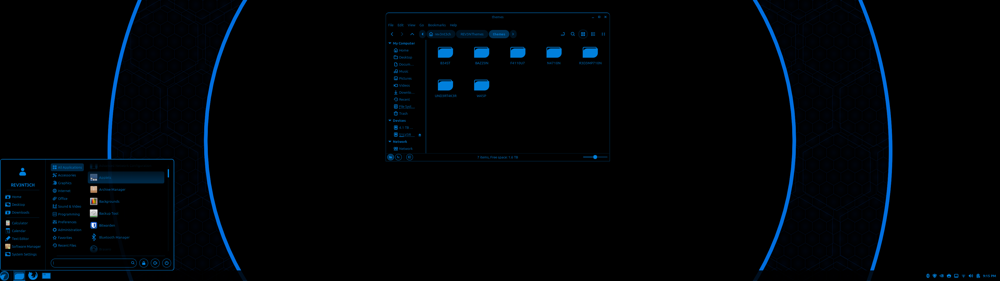
Zorin

## BAZZ0N:
#### 
Mint
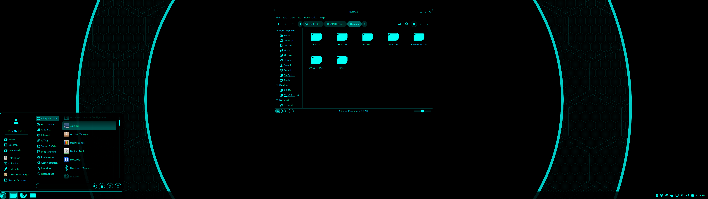
Zorin
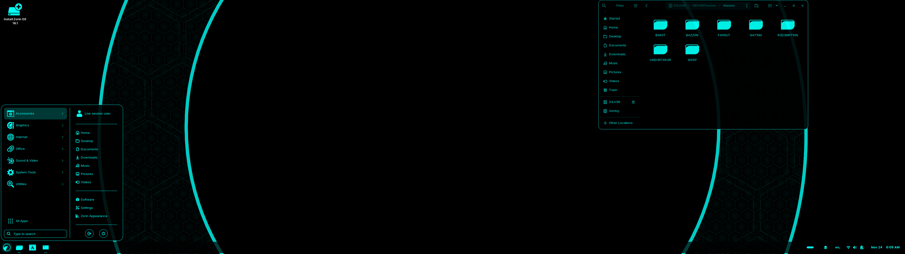

## F4110U7:
#### 
Mint
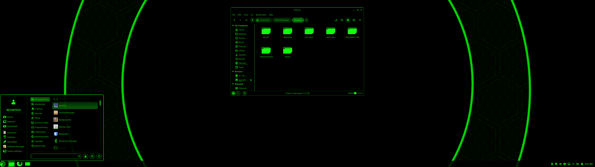
Zorin
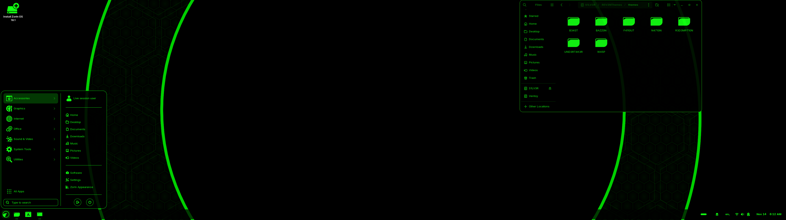

## N4710N:
#### 
Mint
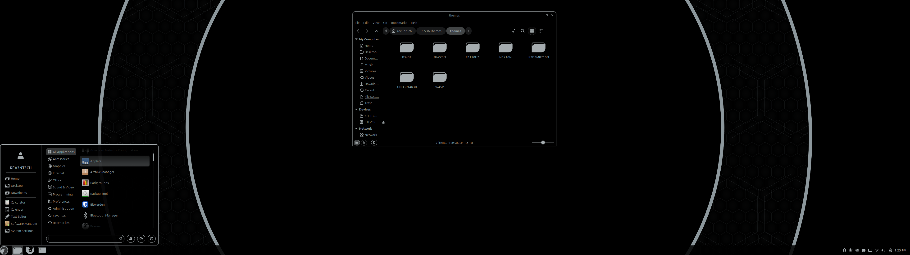
Zorin
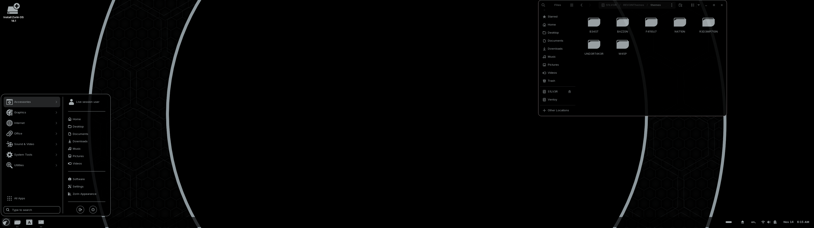

## R3D3MP710N:
#### 
Mint
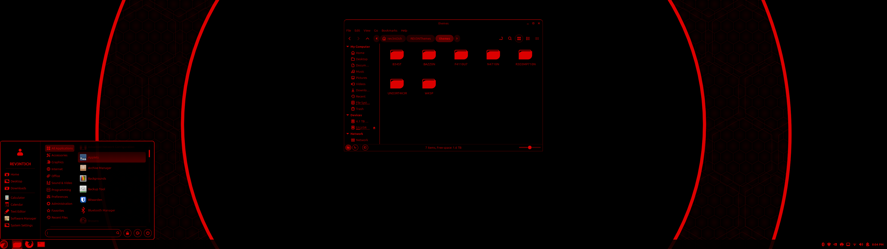
Zorin
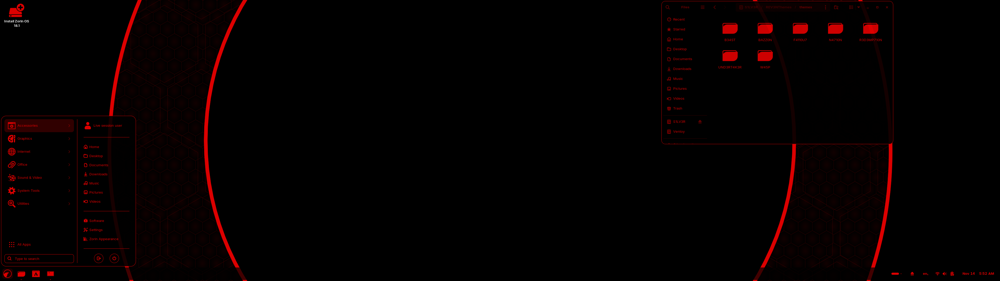

## UND3RT4K3R:
#### 
Mint
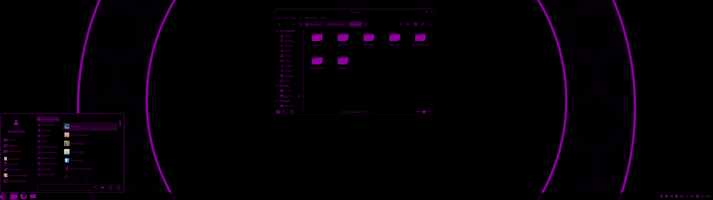
Zorin
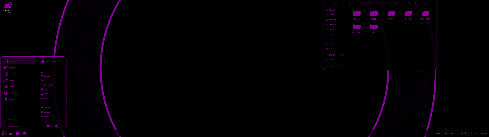

## W45P:
#### 
Mint
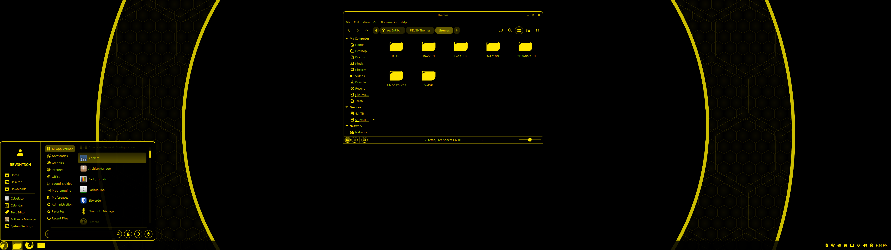
Zorin
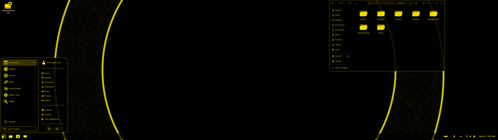
